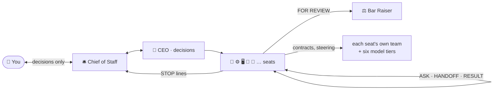

# agent-team

**Seat a team of AI roles in any project.** Say *"set up the team"* and Claude Code scans your repo,
then offers three teams sized to it: **lean**, **recommended** and **full**, every seat with the evidence
that put it there. Seats come from a catalogue of 29 roles (CEO, Engineering, Design, Sales, Mobile,
Security, Data and more), from **merged seats** where one session holds several small roles, and from
**new seats** written for work no catalogue role covers. Each seat is a session with its own rulebook,
its own team of workers on the right model, and a clear line on what it decides and what it brings to you.
Later, say *"re-evaluate the team"* and it measures how each seat actually works and proposes changes.

- **A team sized from evidence, not a template.** The scan reads manifests, file names, CI, deploy
  configs and git history; each proposed seat cites what raised it (*"a payment library is in the
  dependencies"*). A small project gets merged seats; a large one with several apps gets a
  frontend seat per app.
- **The team changes as the work does.** Re-evaluation counts each seat's commits, worker runs,
  inbox and blocked lines, re-scans the repo, and proposes adding, retiring, merging, splitting back
  or splitting seats. Nothing changes without your yes.
- **Roles that think like the best operator of the job at a fast startup**, written as rulebooks
  with sourced principles, a method, hard-won traps, and a fixed way to report.
- **Every seat runs its own team.** The typing goes to cheap, fast models and the thinking to
  strong ones, steered from above. Verbose work stays in the workers' logs; the seat keeps the judgement.
- **Seats cover for each other.** When a seat isn't open, the others call its team, which works
  under its rulebook and leaves a note for when it returns.
- **You're asked only what only you can decide**: anything public, any spend, anything legal or
  irreversible, real forks in direction. Everything reversible happens without you.
- **Speed from cutting work, never from cutting truth**: reversible decisions are made fast; claims,
  numbers and anything public keep every check.



## Install

As a Claude Code plugin, from any session:

```
/plugin install agent-team --marketplace fauzulkc/agent-team
```

or from a shell:

```bash
claude plugin marketplace add fauzulkc/agent-team
claude plugin install agent-team@agent-team
```

From a local clone: `claude plugin marketplace add ./agent-team`, then the install line above.
Without the plugin system: `./install.sh` links both skills, `team-setup` and `team-reevaluate`, into
your global skills.

## Use

1. **Seat the team.** Open Claude Code in your project and say **"set up the team"**. It reads and
   scans the project, sizes it, and asks you once: which of three teams (lean, recommended, full,
   each seat with its reason), what only you do, and whether the team uploads finished work to your
   shared code on its own once checks pass or asks you each time. You can edit the pick: add, drop,
   merge or split a seat. Then it writes the team in (rulebooks, roster, decisions register with
   your answer word for word, one brief per seat, workers, scratch space), and writes the rulebook
   of any new seat for its role before that seat works. All of it happens in that one session.
2. **Open the CEO and the Chief of Staff now**, each in a new session named after it:
   `/seat-ceo catch up and work your inbox`, then `/seat-chief-of-staff catch up and work your inbox`
   (the CEO alone when the team has no Chief of Staff). Open other seats when their work comes up;
   the seats you don't open are covered by their teams. Three to six open at once is typical.
3. **Talk to the Chief of Staff** (or the CEO, when the team has no Chief of Staff) like a person:
   *"Freelancers keep asking for recurring invoices. Let's do it."* It comes back with only what
   needs you, in one shape: decision needed, summary, progress by objective, detail if you ask.
4. **Re-evaluate it** as the work changes: say **"re-evaluate the team"** (after a milestone is a good
   moment). It reports each seat's activity over the last 30 days and what changed in the repo, then
   asks once: apply all, some, or none of its proposals. What you decline is remembered and not put
   to you again unless the repo changes in a way that calls for it. **Change the team by name** any
   time: *"add Motion to the team"*, *"retire Design"*; you named it, so your words are the decision
   and there is no question unless the measurement cuts against them. A role a merged seat already
   holds (*"add Sales"* while 📈 Growth holds it) comes back by splitting that seat into its roles,
   and you are told. **Refresh the rulebooks** after a plugin update: *"sync the team's rulebooks"*;
   rulebooks the project wrote or edited are kept as they are.

A full prompt-by-prompt story on an example project is in [examples/walkthrough.md](examples/walkthrough.md);
the files a seated project carries are in [examples/tally/](examples/tally/) (a smaller team of eight
seats the owner named, on the same app).

## What you'll be asked, and what you won't

| You're asked | You're not asked |
|---|---|
| which team, at setup: lean, recommended or full, with any edits; and whether finished work is uploaded on its own or you're asked each time | how to build what's already in scope |
| a re-evaluation's proposals, once, when you ask for one | each seat one by one, or how a merged or new seat's rulebook is written |
| anything public: posts, emails to customers, invites, press | which worker or model does a task |
| any spend, and prices | routing between seats, covering an absent seat |
| sign-ups, contracts, terms | free, reversible experiments and checks |
| anything irreversible | fixing the team's own docs |
| a real fork that cuts against a preference you stated | ordering work inside the current milestone |
| new goals or milestones | recording decisions you already made |

Questions are batched through one seat, asked once, and your answers are recorded word for word;
a team change you decline is not proposed again unless the repo changes in a way that calls for it.
Full rules: [docs/owner-touchpoints.md](docs/owner-touchpoints.md).

## The model tiers

| Tier | Default model | For |
|---|---|---|
| Quick | Haiku 5.5, low effort | an edit or check a precise brief fully specifies |
| Scout | Haiku 5.5, low effort | read-only searches and counts |
| Check | Haiku 5.5, medium effort | long checklists, finished in full |
| Execution | Sonnet, low effort | each seat's own routine work |
| Build | Sonnet, high effort | multi-file builds, debugging, half-done work |
| Research | Opus, high effort | probes, audits, reviews |
| Deep | Opus, maximum effort | decisions that can't be undone |

Workers start at the cheapest tier that can do the job and move up only when work comes back
half-done: edits climb Quick, Execution, Build; reading and judging climb Scout, Check, Research, Deep. Models are named in one place per project, so a new model is a one-line change.

## Capacity, briefly

- **Seats:** 29 in the catalogue, plus 8 merged seats and 4 new roles setup can create. The scan
  sizes the project as **tiny** (under 60 source files and 50 commits), **small** (under 600 source
  files, three contributors or fewer), **medium** (under 3,000 source files) or **large**, and the
  recommended team scales with it: every allowed merge when tiny, the commercial seats merged when
  small, every role separate when medium, and a frontend seat per UI app when large. Measured on
  invented test projects: a small library gets 5 to 7 seats; a web product that takes sign-ups and
  payments gets 10 lean, and 12 recommended when tiny, 16 when small, 19 when medium; 21 full, or
  22 when it serves an API. The method has run with 21 seats on one production project.
- **Open at once:** each open seat is a Claude session, so your plan's limits set the ceiling; closed
  seats are covered by their teams, so 3 to 6 open seats is a typical day.
- **Workers:** each seat runs waves of background workers, kept under about ten at a time.
- **Not included:** it doesn't run unattended, never acts publicly, spends, signs or makes legal
  determinations without you.

Details: [docs/how-it-works.md](docs/how-it-works.md#capacity-what-to-expect).

## Docs

| | |
|---|---|
| [How it works](docs/how-it-works.md) | the layers, how the team is sized and re-evaluated, the seat rulebook anatomy, the work loop, tiers, messages, capacity |
| [Orchestration diagrams](docs/orchestration-diagrams.md) | the scenarios drawn out, from seating and sizing the team to re-evaluating it, with the prompts at each step |
| [When you're asked](docs/owner-touchpoints.md) | the full line between your decisions and the team's |
| [The seats](docs/seats.md) | all 29, the merged seats and the new roles: what each does, and when to seat it |
| [Walkthrough](examples/walkthrough.md) | an example project, prompt by prompt |
| [Example project](examples/tally/) | the files a seated project carries |

## Develop

`python3 check.py` proves every seat rulebook has its mark, the seven sections, sourced shifts, no
model names and no project-specific facts, and that the generated docs ([seats](docs/seats.md), the
[example](examples/tally/)) match what their generators in `tools/` write today.
`python3 -m unittest discover -s tests` runs the scan, planner, scaffold and re-evaluation against
invented fixture projects, and `python3 tools/measure_tally.py --check` re-measures the walkthrough's
numbers. `claude plugin validate .` checks the plugin. See [CONTRIBUTING.md](CONTRIBUTING.md).

MIT licensed.
