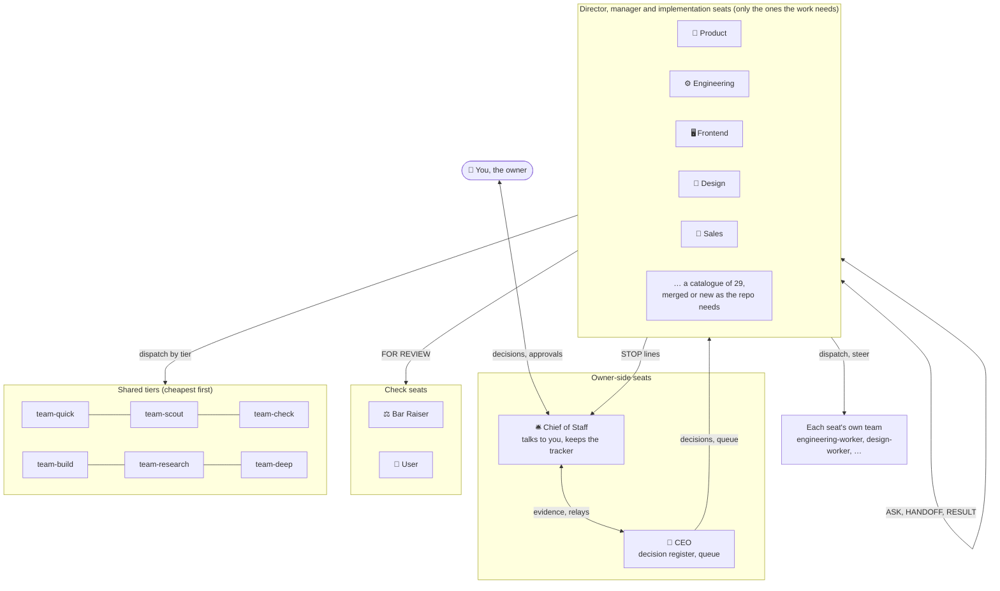
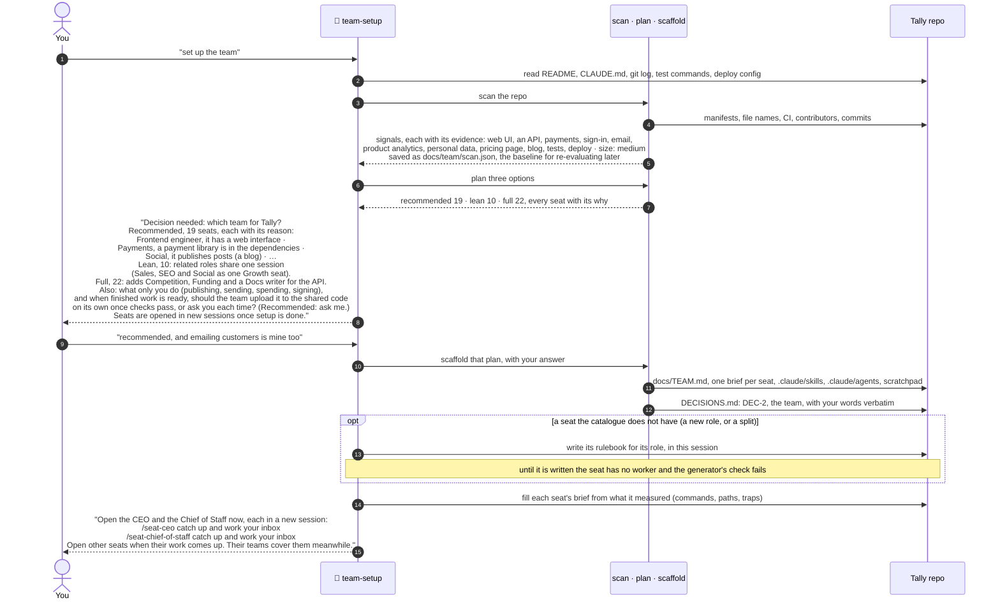
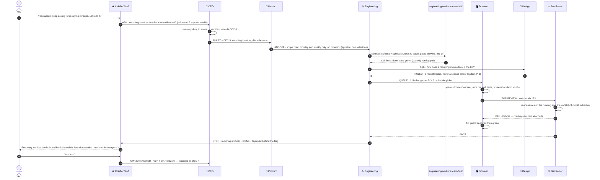
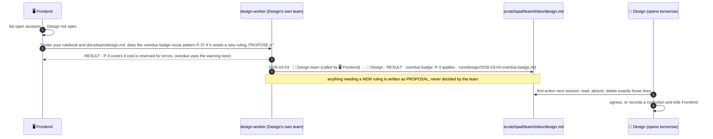
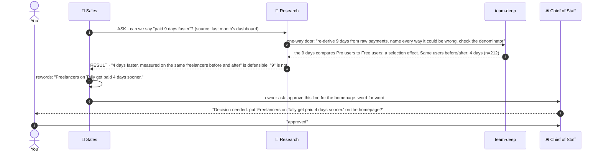
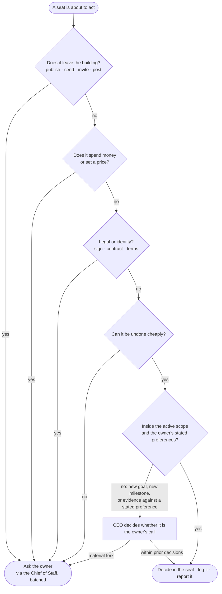
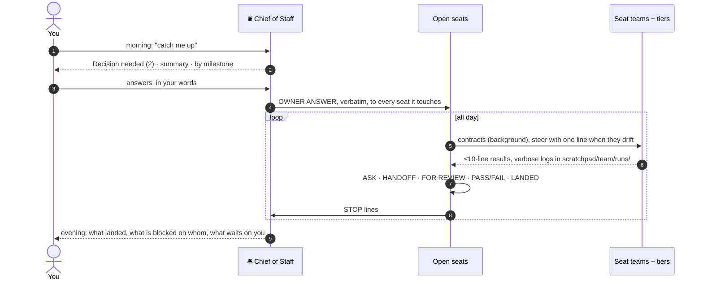
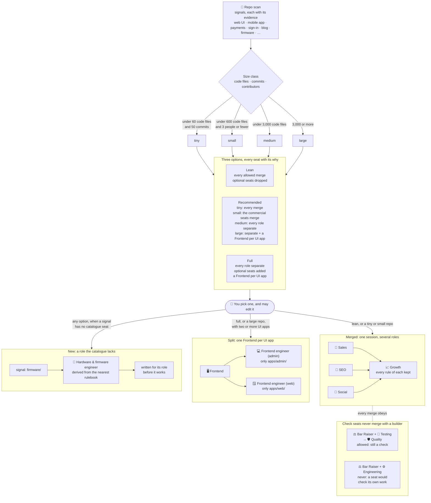
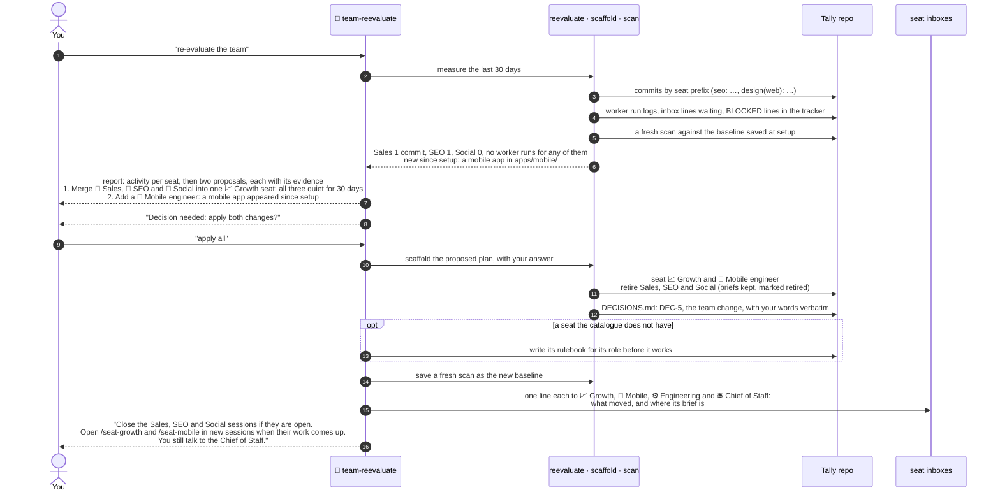

# How the agents orchestrate: scenario diagrams

Every scenario uses one invented example: **Tally**, a small invoicing app for freelancers, run by
its owner with a seated team. The quoted lines are the prompts as typed, by you or by a seat.
The diagrams are [Mermaid](https://mermaid.js.org/); GitHub renders them in place.

**Legend.** *You* are the owner. A **seat** is a Claude session you open with its skill (`/seat-ceo`).
A **team** is that seat's own worker (`engineering-worker`), spawned by the seat. The **tiers**
(`team-quick`, `team-scout`, `team-check`, `team-build`, `team-research`, `team-deep`) are shared workers on
cheaper or stronger models. A **merged seat** is one session holding several roles while their work
is small, every rule of each kept (📈 Growth holds Sales, SEO and Social). A **new seat** is a role
the catalogue does not have, or one seat split per app (🔌 Hardware & firmware engineer): its
rulebook is derived from the nearest one, then written for its role before it works.
**🧩 team-setup** seats the team once; **🔁 team-reevaluate** resizes it later. You run both.

---

## 0 · The shape of the team

---

## 1 · Seating the team

Setup scans the repo, sizes it, and offers three teams, every seat with the evidence that put it
there. Tally's repo measures medium (661 source files, four contributors), so the recommended team
keeps each role in its own seat. A smaller repo gets merged seats instead (scenario 8). The whole
setup runs in this one session; seats are opened in new sessions afterwards.

**Asks you:** once: which of the three teams, with the two settings (what only you do, and whether
finished work is uploaded to the shared code on its own or you're asked each time). You may edit
the pick (add, drop, merge or split a seat). Everything else is measured from the repo. Your answer
is the register's **DEC-2** (DEC-1, the team method, comes with it).

---

## 2 · A feature, from your sentence to shipped

You type one sentence to the Chief of Staff. Six seats and several workers move; you are asked once.

**Asks you:** once, at the end, because turning a feature on for customers is outward. Scope, design,
build, review and the bug fix happened without you. (DEC-2 is the team itself, recorded at setup.)

---

## 3 · A seat is away: its team covers

Design isn't open today. Frontend needs a design ruling and doesn't wait for one.

**Asks you:** never. A team can apply its seat's existing rulings and propose new ones; only the seat rules.

---

## 4 · The tier ladder: start cheap, move up one step

```mermaid
flowchart LR
    task["Task: rename `client` to `customer` across 40 files"] --> quick["team-quick<br/>exact contract, cheapest"]
    quick -->|"returns a summary where the contract asked for the diff list"| exec["engineering-worker<br/>execution tier"]
    exec -->|"two tests now fail: a fixture still says client"| build["team-build<br/>reasons before typing"]
    build -->|"fixed, whole test leg pasted"| review["⚙️ Engineering reviews:<br/>re-runs the load-bearing command"]
    review --> land["commit by explicit paths"]
```

**The rule:** start at the cheapest tier that can do the job. Move up to the next tier that can do
that kind of work only when a worker
returns half-done work: a summary instead of a table, a skipped check, a guess where the contract
said stop, or a fix that doesn't pass the whole test leg. `team-deep` is never a default.

---

## 5 · A one-way door: a public claim

Sales wants a homepage line: *"Freelancers get paid 9 days faster with Tally."*

**Asks you:** once, for the published words. The audit that turned 9 into an honest 4 needed nobody's permission.

---

## 6 · Should this go to the owner?

---

## 7 · A day, end to end

---

## 8 · Sizing the team: merged, separate and new seats

The scan's signals say which roles the repo needs. Its size says how many sessions should hold them.

**The rules:** the CEO and the Bar Raiser are in every option (in lean, the Bar Raiser sits inside
Quality). The Chief of Staff joins from five other seats (seven in lean) and the Scope Trimmer from
ten other seats ("other" leaves out those two), because they earn their seat by the sessions they
coordinate. Check seats (Bar Raiser, Scope Trimmer, User, Security) join only a check merge: Quality
is the one, and no merge a re-evaluation proposes holds the CEO or the Bar Raiser. A merge claims its
members, so two merges never share one. Other new roles come the same way as Hardware & firmware: a
smart-contract, desktop or browser-extension engineer, each raised by its own signal.

---

## 9 · Re-evaluating the team a month later

Tally has worked for a month. You ask for a re-evaluation; it measures, proposes, and changes
nothing until you answer.

**Asks you:** once, after the report. Your answer is one decision row (DEC-5 here, after the two of
scenario 2). Had you said *apply some* or *change nothing*, every proposal you turned down would be
written to `docs/team/declined.json` and not put to you again unless the repo changes in a way that
calls for it. A retired seat keeps its brief, so its history stays readable, and it is not proposed
again unless its signal is new since setup. A merged seat whose work grows to carry the team is
proposed for splitting back into its roles the same way.
