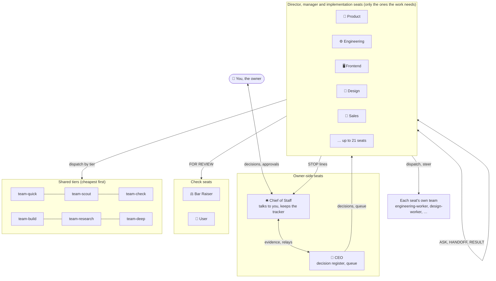
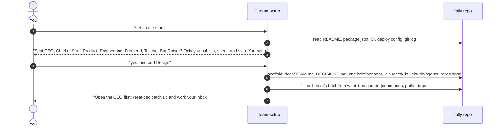
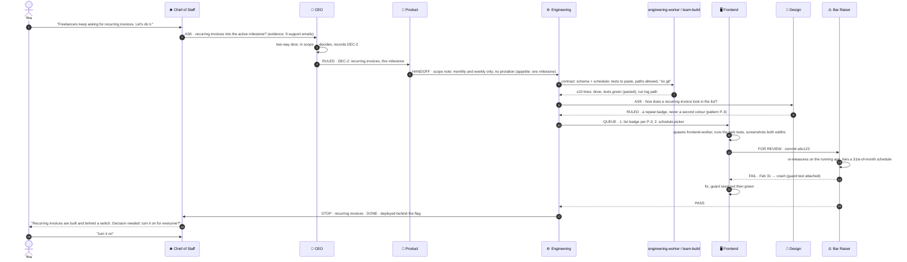
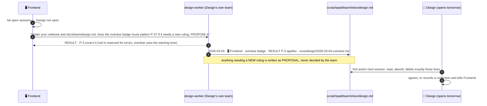
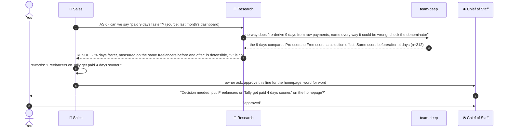
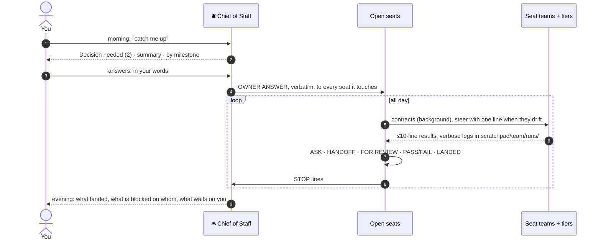

# How the agents orchestrate: scenario diagrams

Every scenario uses one invented example: **Tally**, a small invoicing app for freelancers, run by
its owner with a seated team. The quoted lines are the prompts as typed, by you or by a seat.
The diagrams are [Mermaid](https://mermaid.js.org/); GitHub renders them in place.

**Legend.** *You* are the owner. A **seat** is a Claude session you open with its skill (`/seat-ceo`).
A **team** is that seat's own worker (`engineering-worker`), spawned by the seat. The **tiers**
(`team-quick`, `team-scout`, `team-check`, `team-build`, `team-research`, `team-deep`) are shared workers on
cheaper or stronger models.

---

## 0 · The shape of the team

---

## 1 · Seating the team

**Asks you:** once, for the seats and the two settings. Everything else is measured from the repo.

---

## 2 · A feature, from your sentence to shipped

You type one sentence to the Chief of Staff. Six seats and several workers move; you are asked once.

**Asks you:** once, at the end, because turning a feature on for customers is outward. Scope, design,
build, review and the bug fix happened without you.

---

## 3 · A seat is away: its team covers

Design isn't open today. Frontend needs a design ruling and doesn't wait for one.

**Asks you:** never. A team can apply its seat's existing rulings and propose new ones; only the seat rules.

---

## 4 · The tier ladder: start cheap, move up one step

```mermaid
flowchart LR
    task["Task: rename `client` to `customer` across 40 files"] --> quick["team-quick<br/>exact contract, cheapest"]
    quick -->|"returns a summary where the contract asked for the diff list"| exec["engineering-worker<br/>execution tier"]
    exec -->|"two tests now fail: a fixture still says client"| build["team-build<br/>reasons before typing"]
    build -->|"fixed, whole test leg pasted"| review["⚙️ Engineering reviews:<br/>re-runs the load-bearing command"]
    review --> land["commit by explicit paths"]
```

**The rule:** start at the cheapest tier that can do the job. Move up one tier only when a worker
returns half-done work: a summary instead of a table, a skipped check, a guess where the contract
said stop, or a fix that doesn't pass the whole test leg. `team-deep` is never a default.

---

## 5 · A one-way door: a public claim

Sales wants a homepage line: *"Freelancers get paid 9 days faster with Tally."*

**Asks you:** once, for the published words. The audit that turned 9 into an honest 4 needed nobody's permission.

---

## 6 · Should this go to the owner?

---

## 7 · A day, end to end

